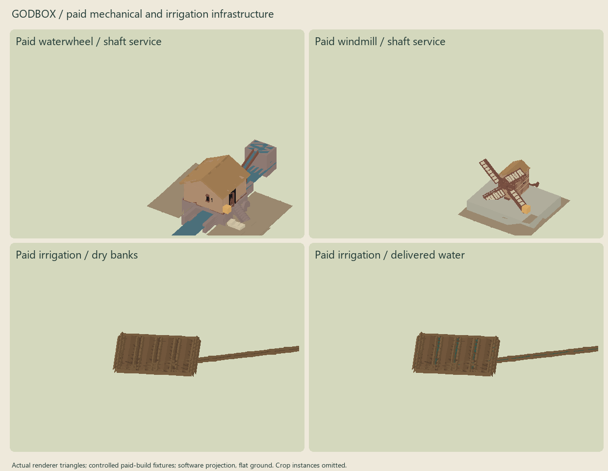

# Civilization progression repair

Status: final multi-seed simulations are running. This document will receive measured end states before the repair is committed.

## What changed

Knowledge access and construction stock now have separate meanings. Recent delivered material and accepted production provide decaying evidence for experimentation. Physical inventory, owned facility yards, fuel, labour and maintenance still constrain building and operation. Internal yard returns do not create new receipts. A twelve-month equivalent is a rate-based access measure, not a second spendable warehouse.

The old economy temporarily added extraction demand to wood and stone projections. Annual construction could spend that projection before physical reconciliation. Demand now remains in `monthlyBalance`; upkeep withdraws real material, and infrastructure reconciles its charges immediately. The separate industrial conversion of timber/minerals into abstract goods was removed because physical recipes already produce that value.

Households issue real pottery and textiles, wear them out, and order replacements. Cooking consumes timber and tending labour in warm climates as well as cold ones. This supplies continuing demand and heat experience rather than making a kiln stop permanently at a fixed idle stock target. Routine and emergency freight reserves use the same inventory semantics; normalized food security no longer has to exceed an impossible 1.1 before exporting food.

Genuine agricultural surplus supports at most one new apprenticeship per settlement per year. It preserves a farming base and requires sustained production, a food reserve, adequate health/security and a stable career. It changes occupation without granting expertise. Larger working teams learn with diminishing returns, and recent actual extraction, heat, craft, accounting, repair, transport and agricultural activity supports practice. Losing workers, fuel, access or institutions still matters.

Trade teaching advances on completed encounters rather than aliasing to the shipment's calendar phase. It rotates the curriculum and considers volume, distance, literacy, affiliation, openness and disruption. Nearby literate administrations can finance teaching from institutional resources. Unsupported imported practical knowledge remains dormant; it supplies neither equipment nor a grid. Existing migration and conquest channels remain available.

Wheel/axle and simple wooden gearing enable waterwheels and windmills before precision machinery or electricity. A powered sawmill additionally requires real metallurgy and paid metal blades. Food and manufacturing plots can host appropriate machines. Grain handling uses supplied shaft power to collect an existing harvest faster; heat from a kiln no longer impersonates agricultural machinery. Construction counts planned capacity to avoid unnecessary duplicate plants while the first plant is incomplete.

Hydraulic generation and presentation share a survey of canonical freshwater and banks. A short race can reach a nearby stream from a dry-bank settlement; absent water, weak discharge and excessive bank height remain constraints. Wind investment uses the existing wind climate rather than assuming rated wind. Cooling, fuel, storage, dispatch, actual consumers and grid construction retain their existing physical authorities.

Industrial stage progression now requires recent productive physical facilities and supplied power. Stage changes do not grant free factories/workshops. Factory investment can begin during commercial mechanization rather than waiting for the finished industrial stage that needs factories.

Visible era uses dominant building fabric, adopted capabilities, recent productive facilities, supplied power and industrial intensity. One high-level structure cannot modernize a settlement. Electricity knowledge does not create lamps or industrial streets. Existing BuildingSpec, energy assets, operating rotors and grid lighting remain the rendering authorities.

Irrigation requires paid, maintained distribution works before fields receive managed water. Timber, stone and the shared infrastructure labour budget construct a short intake and field ditches. A surveyed route rejects ridges and obstructing structures. Renderer and simulation use the same ditch layout; dry banks persist and delivered water wets the bed. The aggregate irrigation yield bonus is disabled for authoritative physical fields.

## Reproduction

Run from the repository root with the existing dependencies installed:

```powershell
npx tsx scripts/progression-reachability.ts
npx tsx scripts/progression-audit.ts alpha-river 600 output/progression-repair/paid-installments/alpha-river.json
npx tsx scripts/progression-audit.ts basalt-coast 600 output/progression-repair/paid-installments/basalt-coast.json
npx tsx scripts/progression-audit.ts north-steppe 900 output/progression-repair/paid-installments/north-steppe.json
python scripts/summarize-progression.py --before output/progression-repair/before-expanded/alpha-river.json output/progression-repair/before-expanded/basalt-coast.json --after output/progression-repair/paid-installments/alpha-river.json output/progression-repair/paid-installments/basalt-coast.json output/progression-repair/paid-installments/north-steppe.json
```

All runs begin with 360 people and default simulation settings. The audit neither grants knowledge nor supplies construction inputs. It observes every simulation month, samples every year, and records first discovery/adoption/transformation and first useful operation separately. Twenty-five-year checkpoints expose partial coverage without presenting it as completion. Outputs include source fingerprints, configuration, population and vital statistics, occupations, food ledgers, physical stocks, decaying flows/access, blockers, facility conservation telemetry, plants, service, grid lines, irrigation, docks/roads/bridges and rendered era.

The baseline was preserved before repair, including the user's existing unrelated work. Two 180-year baseline runs use the same expanded collector. Comparisons use a common 180-year window; longer horizons are reported separately. Existing narration/warfare changes were preserved and are excluded from this repair's commit. They form part of the measured worktree, so source fingerprints identify the exact source used; a clean checkout without those changes can produce different histories.

Prototype experiments now name the material they examine: clay for refractory vessels, worked metal for precision machinery, ash or copper ore for chemical observation, and copper plus iron/steel for electrical equipment. This removes unrelated idle-quarry-stock requirements while preserving prerequisite knowledge, crew/institution gates, discovery difficulty, purchasing power and full physical construction bills.

Settlement projects begin with the same 8% initial delivery coverage already used by their structural-material authority. Their existing installment ledger still charges the entire declared bill before completion. The blanket 12-unit timber reserve for energy sites was removed; plant operation retains its actual fuel requirements. A low-stock regression starts a paid partial site and proves it cannot complete without further deliveries.

## Structural audit and tests

[The inspectable dependency graph](progression-dependencies.json) covers knowledge, alternative prerequisites, raw extraction, both recipe catalogs, infrastructure, facility construction bills, productive power and industrial paths. Least-fixed-point reachability distinguishes a hard deadlock from a cycle with a usable alternative. Strongly connected components are reported separately. This tests structural possibility; it does not certify that every landscape has sufficient deposits, specialists, institutions or reserves, or that a stochastic discovery occurs by a deadline.

Batched diagnostic queries refresh indexes once per settlement rather than once per missing catalog entry. A ten-year comparison produced identical complete audit output against individual queries. This only changes inspection work.

Regression scenarios cover delivered access without spendable stock, legitimate scarcity, equipment conservation and replacement, paid fire tending, real surplus apprenticeships, diminishing returns and activity, fair teaching rotation, an imported resource enabling local experimentation, mechanical production and grain handling without electricity, electricity awareness without powered visuals, an isolated high-level landmark, circular dependencies, paid irrigation before visible channels, and dry-bank hydraulic access with absent-water/high-bank rejection. Existing knowledge history tests check repeatability and divergence across seeds.

## Visual verification and limits



The image projects actual renderer triangles from controlled paid-build fixtures. It verifies machinery form and persistent dry/wet irrigation channels. It uses flat ground and omits instanced crops; it is not a screenshot of an organic advanced city. [The existing electrical asset review](energy-grid-review.png) is also a controlled fixture. Functional tests are separate from organic progression evidence.

Grain handling is represented through the existing aggregate food/harvest authority; it is not a separate flour commodity. Short irrigation races model gravity or hand lifting; they do not imply long aqueducts, unlimited pumping or catchment-scale water allocation. The hydraulic survey uses the existing canonical terrain and normalized flow, not a full engineering head/discharge calculation. Decaying store withdrawals include dispatch to facilities; facility conversion totals separately identify consumed inputs. Food production is gross model production and may subsequently spoil or overflow.

Population growth is not guaranteed. Baseline towns already exceeded 150 people (largest observed: alpha-river 169, basalt-coast 205), disproving a hard settlement-size ceiling. Food stocks alone do not remove reproductive age structure, disease, exposure, housing pressure, migration or war mortality. The report must distinguish these constraints from progression deadlocks rather than suppressing them.
