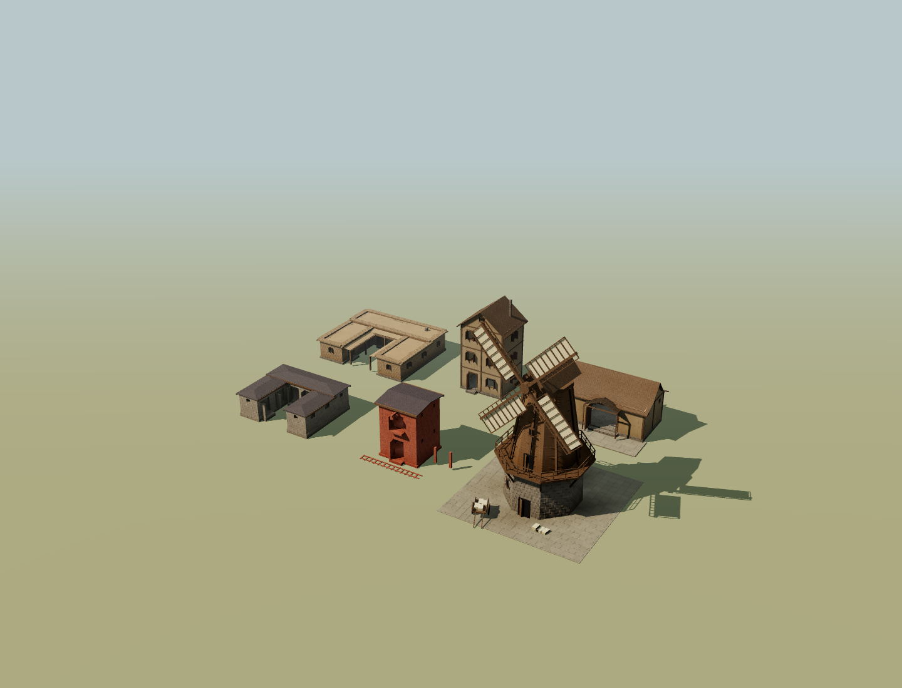

# GODBOX production architecture: flagship pass

The catalogue was not world class. This pass establishes a stronger production standard with function-led forms, coherent joinery and roof construction, and rooms that people can actually enter. The review scene uses the same AssetBuilder and material shaders as the simulation; none of the featured architecture is a viewer-only model.

## Inspect the result

Run `npm run dev -- --port 5175`, then open [the interactive review](http://127.0.0.1:5175/architecture-flagships.html). Orbit, isolate each building, switch to neutral materials, and inspect the real moving mill. Controlled weather drives the production MillMotionSystem. The six fixtures deliberately select period and material evidence; this is an architectural review, not a saved simulation settlement or proof of their natural appearance frequency.

[Unlabeled neutral comparison](all-neutral.png). Individual material and neutral views are included for every fixture.

## Production changes

- Arid courtyard houses have three connected ranges, an open court, supported shaded galleries, restrained parapets and room widths resolved from wall thickness. Temperate timber town houses have street-facing gables, real attic lights, floor beams, principal posts and open shutters.
- Threshing barns have an unobstructed wagon route and a supported gabled wagon porch. Stable yards have distinct low roofed ranges, inward-facing stall access and an open working court. Byres retain their separate low asymmetric feeding-passage form.
- Multi-storey granaries have actual loading cuts, bracketed landings and a timber loading boom. The smock mill retains its dedicated architecture and real drivetrain; triangular assembly geometry now belongs to recorded construction pieces.
- Roof skins, gable cheeks, reveals, purlins and rafter supports follow each physical section. Wall emitters cut full-thickness holes. Available glass is recessed in those holes; non-glass windows have open wooden shutters. Framed walls use the resolved infill material.
- Shared mass and partition plans publish the same doors and room boundaries to facade metadata, navigation and sleeping presentation. Beds remain under roofed ranges; courtyards stay at terrain level. Interior routes pass through actual entrances and detour around partitions.
- BuildingSpec retains architectural authority. Seeded determinism, historical/material resolution, construction stages, assembly ranges, contact shading and material batching remain in the production path. SVG remains optional surface decoration.
- Mid-distance assets retain primary openings and functional access using cut envelopes. Far assets preserve courts, street-gable orientation and porch silhouettes. Farm field buildings use the same placement and scale in every LOD. Construction decks persist through services/joinery and leave during finishing.

## Before and after

The following neutral sheets render production structural triangles with equal surface treatment and no labels, props or textures. Top row is the earlier functional-shell pass; bottom row is this flagship pass. Left to right: house, barn, byre, stable, granary. Each cell is fitted independently. The original generic-shell baseline remains documented in [the first audit](../architecture-identity/README.md).

- [Bronze / Iron Age](comparison-bronzeIron.png)
- [Medieval](comparison-medieval.png)
- [Industrial](comparison-industrial.png)
- [Contemporary](comparison-contemporary.png)

The complete active catalogue remains visible as controls in [Bronze / Iron Age](catalogue-bronzeIron.png), [Medieval](catalogue-medieval.png), [Industrial](catalogue-industrial.png) and [Contemporary](catalogue-contemporary.png) sheets. This pass does not claim that every control received the same level of redesign.

## Validation and budgets

The production build passes. Browser capture exercised fourteen material/neutral views through actual WebGL on NVIDIA RTX 4060 / ANGLE D3D11, with no recorded runtime or shader errors. The capture harness verifies that production mill rotations advance. See [WebGL report](webgl-report.json).

The five new building fixtures peak at 9,358 full-detail vertices and six meshes, 1,176 mid-distance vertices and four meshes, and 44 far-distance vertices. The dedicated moving mill uses 26,476 vertices and ten meshes. [Measured asset budgets](metrics.json).

Regression checks cover real opening raycasts against intact-wall controls, clear wagon access, gable lights, open-to-sky courts at every LOD, transformed entrances, roofed sleeping positions, connected routes around physical partitions, construction piece coverage, material legality and bounded rendering costs. Vertex counts are budget checks, not the evidence of architectural distinctness.

A broader selected suite passed 259 tests before the final batching adjustment. The closing suite passed 143 tests across eight files, including the new flagship and concurrent lifecycle checks. The first audit records unrelated baseline failures in the whole simulation suite; a selected architecture suite is not a claim that the entire repository is green.

## Remaining limitations

The whole catalogue and the resulting streets are not yet uniformly world class. Regional plan vocabularies, historically specific roof joints, incremental extensions and richer interiors need further work. The loading boom is a static architectural fitting; rope rigging and hoisting are not simulated. Compound joints are simplified rather than archaeological reconstructions. Small secondary openings disappear at middle LOD, and distant silhouettes omit wall openings. The curated review demonstrates production capabilities, not settlement-level frequency or pacing. Separate concurrent lifecycle/reachability work in the workspace is preserved.
